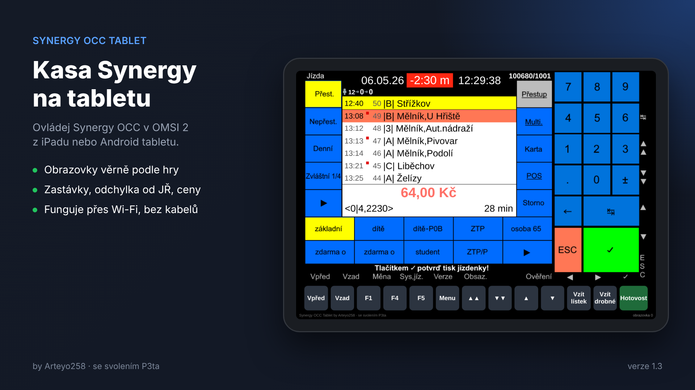

# Synergy OCC Tablet

Ovládání kasy **Synergy OCC** v **OMSI 2** z tabletu nebo telefonu (iPad, Android) přes prohlížeč.

Autor: Arteyo258 · se svolením P3ta (Synergy OCC: P3ta, Jack Black, Swix)



## Stažení a instalace

Hotový `SynergyTablet.exe` najdeš v sekci [Releases](../../releases). Stačí ho spustit – sám najde OMSI 2, nainstaluje plugin a ukáže adresu a QR kód pro tablet. Podrobný návod je v [docs/CTI_MNE.txt](docs/CTI_MNE.txt).

## Jak to funguje

```
OMSI 2 ── plugin SynergyBridge.dll ──UDP 127.0.0.1:38600/38601── SynergyTablet.exe ──HTTP :8765── tablet (prohlížeč)
```

- **plugin/** – 32bitový OMSI plugin. Čte proměnné a texty Synergy, posílá je aplikaci a spouští triggery (stisky tlačítek kasy).
- **app/** – Windows aplikace (Win32, bez závislostí). Obsahuje HTTP server, webové UI (`app/index.html`), instalátor pluginu a diagnostiku. Plugin i UI jsou zabalené uvnitř exe.
- Textury kasy se čtou za běhu z instalace Synergy OCC u uživatele – **repo neobsahuje žádné soubory Synergy**.

## Sestavení

Linux nebo WSL s balíčkem `mingw-w64`:

```sh
sudo apt install mingw-w64
./build.sh
```

Výsledek je v `dist/SynergyTablet.exe`. Stejně se aplikace sestavuje na GitHub Actions (`.github/workflows/build.yml`), odkud pochází i oficiální vydání.

Seznam proměnných a triggerů je v `plugin/gen.py`. Po jeho úpravě spusť `python3 plugin/gen.py` – přegeneruje `plugin/names.h` a `plugin/SynergyBridge.opl`. Volitelně mu jde předat složku se seznamy `alltrig.txt` a `allv.txt` vytaženými ze skriptů Synergy pro kontrolu názvů.

## Co aplikace dělá se systémem

Aby bylo jasné, proč antivirus může být podezíravý:

- kopíruje plugin do `OMSI 2\plugins` (pokud je složka chráněná, vyžádá si práva správce),
- na vyžádání přidá pravidlo do Windows Firewallu (`netsh`, práva správce),
- tlačítko „Vzít drobné“ posílá do hry klávesu Shift+T,
- poslouchá na portu 8765 (HTTP pro tablet) a na 127.0.0.1:38600 (data z pluginu),
- nastavení ukládá do `%APPDATA%\SynergyTablet\config.ini`.

Nic dalšího neinstaluje, nic neposílá na internet.

## Licence

Kód v tomto repu je pod licencí [MIT](LICENSE). Synergy OCC je dílo P3ty, Jacka Blacka a Swixe a do této licence nespadá.
